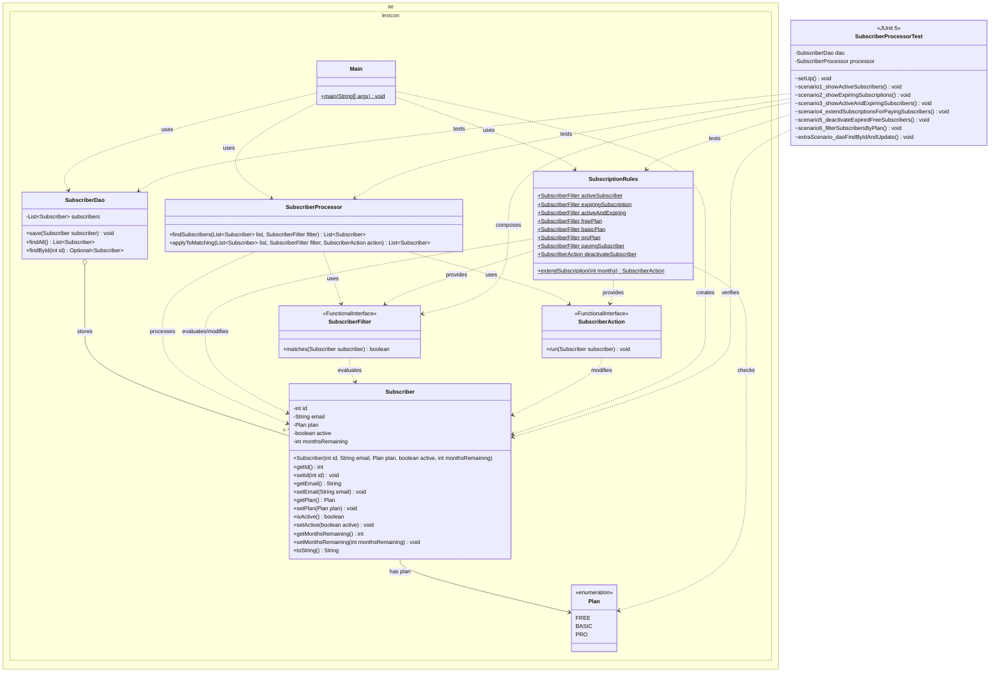

# Subscription Manager

A lightweight Java application for managing user subscriptions using **Java Functional Interfaces**, **Lambda Expressions**, and the **Stream API**. The project demonstrates how to decouple filtering logic and state mutations from data storage using clean, reusable rules.

---

## Table of Contents
- [Features](#features)
- [Architecture & Class Diagram](#architecture--class-diagram)
- [Component Overview](#component-overview)
- [Project Structure](#project-structure)
- [Getting Started](#getting-started)
- [Running Tests](#running-tests)

---

## Features
* **In-Memory Data Access (`SubscriberDao`):** Supports saving new subscribers, updating existing records by ID (upsert behavior), and querying subscribers safely via defensive copies and `Optional`.
* **Custom Functional Interfaces:** Uses `@FunctionalInterface` contracts (`SubscriberFilter` and `SubscriberAction`) to encapsulate predicate checks and state modifications.
* **Composable Business Rules (`SubscriptionRules`):** Provides ready-to-use static filters (active, expiring, free, basic, pro, paying) and parameterized actions (extending subscription months or deactivating accounts).
* **Stream Processing Engine (`SubscriberProcessor`):** Filters subscriber lists and applies batch updates cleanly using Java Streams.
* **Comprehensive Unit Testing:** Includes a JUnit 5 test suite covering all business rules, combined filter predicates, batch mutations, and DAO edge cases.

---

## Architecture & Class Diagram

The diagram below illustrates the relationships between the domain models, data access layer, functional interfaces, business rules, main entry point, and JUnit test suite.



---

## Component Overview

### 1. Domain Model
* **`Plan` (Enum):** Defines the available subscription tiers: `FREE`, `BASIC`, and `PRO`.
* **`Subscriber` (Class):** Represents a customer account with an `id`, `email`, `plan`, `active` status flag, and `monthsRemaining` counter.

### 2. Data Access Layer
* **`SubscriberDao` (Class):** Manages an internal `ArrayList<Subscriber>`. Its `save()` method performs an upsert—updating an existing record if the ID is already present or inserting a new one otherwise. `findAll()` returns a defensive copy of the list, and `findById()` returns an `Optional<Subscriber>`.

### 3. Functional Interfaces
* **`SubscriberFilter`:** A `@FunctionalInterface` with a single boolean method `matches(Subscriber)` used to evaluate whether a subscriber satisfies a condition.
* **`SubscriberAction`:** A `@FunctionalInterface` with a void method `run(Subscriber)` used to perform side effects or state updates on a subscriber.

### 4. Business Logic & Processing
* **`SubscriptionRules` (Utility Class):** Houses reusable lambda implementations for filtering (`activeSubscriber`, `expiringSubscription`, `activeAndExpiring`, `freePlan`, `basicPlan`, `proPlan`, `payingSubscriber`) and actions (`extendSubscription(int months)` and `deactivateSubscriber`).
* **`SubscriberProcessor` (Class):** Executes queries via `findSubscribers()` and performs batch updates via `applyToMatching()`.

### 5. Application & Tests
* **`Main`:** Seeds sample subscribers, compares standard inline Java Streams against `SubscriberProcessor`, and demonstrates extending expiring plans and deactivating free accounts.
* **`SubscriberProcessorTest`:** A JUnit 5 test suite validating 7 distinct scenarios, including rule composition (combining filters with `&&`), batch extensions, deactivations, and DAO update behavior.

---

## Project Structure

```text
SubscriptionManager/
├── pom.xml
└── src/
    ├── main/
    │   └── java/
    │       └── se/
    │           └── lexicon/
    │               ├── Main.java
    │               ├── Plan.java
    │               ├── Subscriber.java
    │               ├── SubscriberAction.java
    │               ├── SubscriberDao.java
    │               ├── SubscriberFilter.java
    │               ├── SubscriberProcessor.java
    │               └── SubscriptionRules.java
    └── test/
        └── java/
            └── SubscriberProcessorTest.java
```

---

## Getting Started

### Prerequisites
* **Java Development Kit (JDK):** Java 17 or higher recommended.
* **Apache Maven:** For dependency management and running tests.

### Build & Run
1. Clone the repository and navigate to the project directory:
   ```bash
   git clone https://github.com
   cd workgroup/SubscriptionManager
   ```
2. Compile the project using Maven:
   ```bash
   mvn compile
   ```
3. Run the `Main` class:
   ```bash
   mvn exec:java -Dexec.mainClass="se.lexicon.Main"
   ```

---

## Running Tests

Execute the JUnit 5 test suite (`SubscriberProcessorTest`) using Maven:

```bash
mvn test
```

### Covered Test Scenarios

| Test Method | Description |
| :--- | :--- |
| `scenario1_showActiveSubscribers` | Verifies that only subscribers with `active == true` are returned. |
| `scenario2_showExpiringSubscriptions` | Verifies matching of subscribers with `0` or `1` month remaining. |
| `scenario3_showActiveAndExpiringSubscribers` | Verifies combined rule filtering for active accounts nearing expiration. |
| `scenario4_extendSubscriptionsForPayingSubscribers` | Combines multiple filters (`activeAndExpiring` + `payingSubscriber`) and extends matching subscriptions by 3 months. |
| `scenario5_deactivateExpiredFreeSubscribers` | Deactivates accounts on the `FREE` plan with `0` months remaining. |
| `scenario6_filterSubscribersByPlan` | Verifies filtering by a specific `Plan` tier (`Plan.PRO`). |
| `extraScenario_daoFindByIdAndUpdate` | Confirms `Optional.empty()` for missing IDs and verifies in-place updates without duplicating records. |
