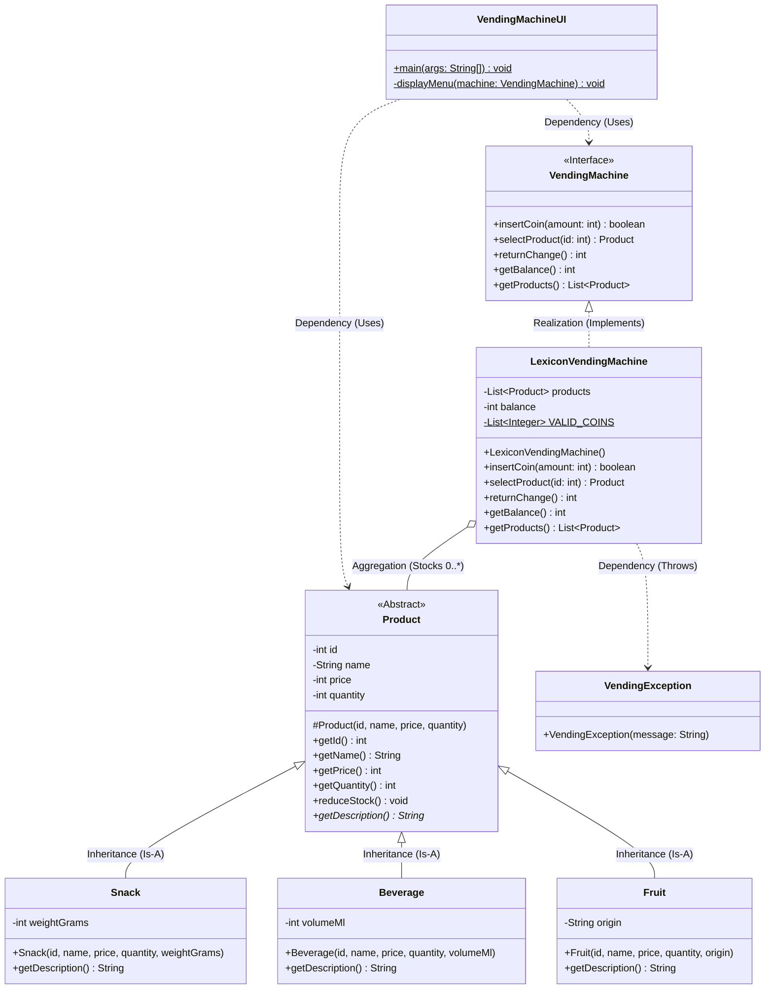

# Lexicon Vending Machine Application


A modular, object-oriented Java application designed to power a break room vending machine. The engine handles product inventory tracking, transactions using standard Swedish Krona (SEK) coin values, balance management, and change returns with strict separation between core business logic and the console user interface.
## Class Diagram


## Prerequisites

Ensure you have the following installed on your operating system:
* **Java Development Kit (JDK 17 or higher)**
* **Apache Maven** (for dependency resolution and package compilation)

To verify your environment variables are configured correctly, open a terminal window and run:
```bash
java -version
mvn -version
```

---

## Project Structure Check

Before compiling, verify your local files are placed under the standard Maven folder blueprint:

```text
├── pom.xml
└── src
    ├── main
    │   └── java
    │       ├── Product.java
    │       ├── Snack.java
    │       ├── Beverage.java
    │       ├── Fruit.java
    │       ├── VendingMachine.java
    │       ├── LexiconVendingMachine.java
    │       ├── VendingException.java
    │       └── VendingMachineUI.java
    └── test
        └── java
            └── VendingMachineTest.java
```

---

## 🛠️ Step 1: Run the Automated Unit Tests

Execute the JUnit 5 business rule test suite directly from your terminal to verify that core transactions, coin verification parameters, and out-of-stock protections operate exactly as expected:

```bash
mvn test
```

---

## 📦 Step 2: Build and Package the Executable JAR

To compile the application code, package the binaries, and generate an executable file, run the following lifecycle goal from the root directory containing your `pom.xml`:

```bash
mvn clean package
```

This updates your local environment and creates a deployment directory named `/target`. Inside it, you will find the main application file:  
`target/lexicon-vending-machine-1.0-SNAPSHOT.jar`

---

## 🚀 Step 3: Run the Application

Launch the compiled program inside your terminal with the following standard execution command:

```bash
java -jar target/lexicon-vending-machine-1.0-SNAPSHOT.jar
```

### 🎮 How to Interact with the Machine Engine
Once the program starts up, it displays the item inventory menu and boots up an interactive loop. Type any of the following shortcut choices into the command marker (`> `) to test operational scenarios:
* `i` or `insert` — Prompt the console to insert coins (`1`, `2`, `5`, `10`, `20`, or `50`).
* `s` or `select` — Choose an item to buy by typing its designated numerical ID (`1`, `2`, or `3`).
* `r` or `return` — Safely clear out out the engine's active balance cache and return your change.
* `m` or `menu` — Re-print the visual menu layout grid to show active pricing and remaining stock counts.
* `e` or `exit` — Securely terminate the session loop and clear any lingering coin changes automatically.
